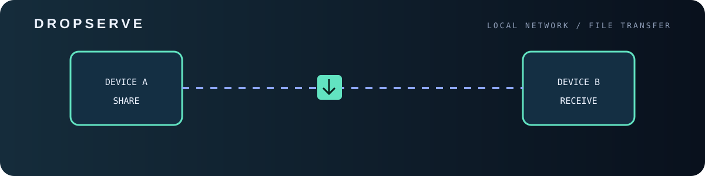
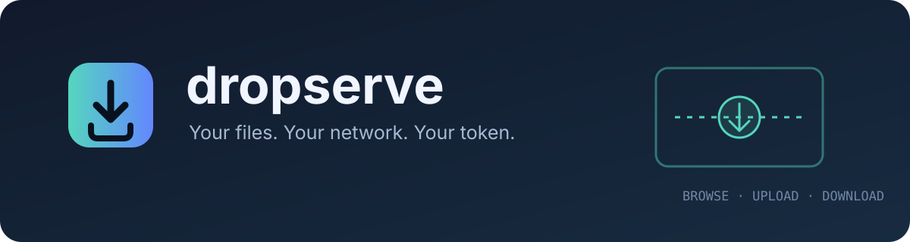

<p align="center">

<p align="center"></p>
  
</p>

<p align="center">
  
  
  
</p>

# dropserve

**A one-file, zero-dependency Python LAN file share.** Open a browser on another device on the same network to browse, download, and drag-and-drop upload files. Access is protected by a private token.

## Quick start

```bash
python dropserve.py --directory ./shared
```

The server prints a randomly generated access token and the port to open. On another device connected to the same network, visit:

```text
http://<host-computer-LAN-IP>:8765
```

Enter the token when prompted. Keep it private: anyone with the token can access the shared directory and upload files to it.

## Options

```text
dropserve.py [--directory PATH] [--host ADDRESS] [--port PORT]
            [--token TOKEN] [--max-size MIB]
```

| Option | Description | Default |
|---|---|---|
| `-d, --directory PATH` | Directory to share; created if missing | `.` |
| `-H, --host ADDRESS` | Address to bind to | `0.0.0.0` |
| `-p, --port PORT` | TCP port; `0` selects an available port | `8765` |
| `-t, --token TOKEN` | Set your own access token (minimum 8 characters) | Random token |
| `--max-size MIB` | Maximum size of an individual upload | `512` |
| `-V, --version` | Print version | — |
| `-h, --help` | Show help | — |

### Examples

```bash
python dropserve.py -d ~/Shared
python dropserve.py -d ./drop -p 9000 -t 'use-a-long-random-token'
python dropserve.py -d ./drop --max-size 2048
python dropserve.py -H 127.0.0.1
```

## Features

- Browser-based file listing with file sizes.
- Direct downloads with safe attachment filenames.
- Drag-and-drop and multi-file uploads from desktop and mobile browsers.
- Token login backed by a signed, HttpOnly, SameSite session cookie; the token is not placed in URLs.
- Upload size limits, filename sanitization, and automatic renaming instead of overwriting existing files.
- Standard-library only: no Flask, FastAPI, Node.js, or third-party packages.

## Security notes

- The default bind address (`0.0.0.0`) exposes the service to reachable network interfaces. Use it only on a trusted network and stop it with `Ctrl+C` when finished.
- The token is printed once at startup. Do not share it with people who should not access the files.
- This is an HTTP LAN utility, not an Internet-facing production file server. It does not provide TLS. Do not forward its port to the public Internet; use a trusted VPN or a properly configured HTTPS reverse proxy if remote access is required.
- Anyone who has the token can list and download shared files and upload new files. The tool does not delete or overwrite existing shared files through its web interface.

## Requirements

- Python 3.8 or newer
- No external Python packages
- Linux, macOS, or Windows

## Tests

```bash
python -m unittest discover -s tests -v
```

## License

MIT — see [LICENSE](LICENSE).